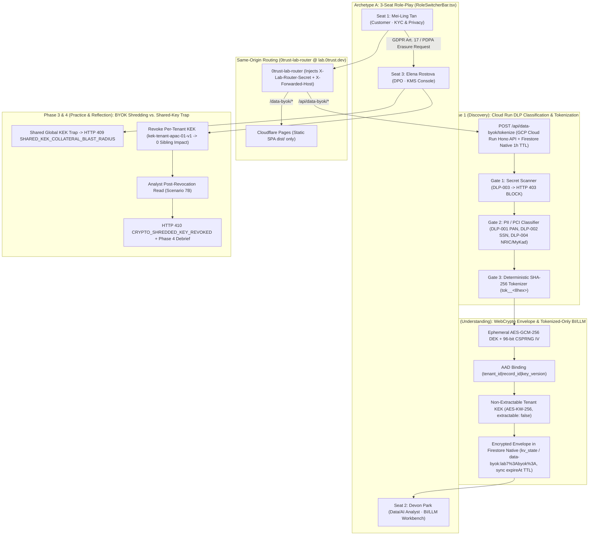

# Lab 7 Architecture: Data Classification, Masking & BYOK Crypto-Shredding (`/data-byok`)

> **Zoom Level:** 2.5 (Lab Assembly + 3-Seat Role-Play + Cryptographic Boundary Mapping)  
> **Parent Overview:** [`0trust.dev/docs/ARCHITECTURE.md`](https://github.com/c2pig/0trust.dev/blob/main/docs/ARCHITECTURE.md)  
> **Lab Manifest:** [`lab.manifest.json`](../lab.manifest.json)  
> **Architecture Diagram:** [`docs/diagrams/data_byok_architecture.svg`](diagrams/data_byok_architecture.svg)  
> **Experience Shell:** Compact AppShell with dropdown [`RoleSwitcherBar`](../src/components/RoleSwitcherBar.tsx) (*Mei-Ling Tan · Customer* ↔ *Devon Park · Data Analyst* ↔ *Elena Rostova · Data Protection Officer*), [`driver.js`](https://driverjs.com/) orientation tour (`Lab Tour`), and sticky-bottom [`XRayTelemetryDrawer`](../src/components/XRayTelemetryDrawer.tsx).

---

## 1. End-to-End 3-Seat Lab Architecture

---

## 2. Distributed Repo & Module Ownership

| Lab Stage & Seat | Plain-English Purpose | Owning File / Source |
| :--- | :--- | :--- |
| **Seat 1 (`customer-kyc`) — DLP & Tokenization API** | Classify PII/PCI/secrets on GCP Cloud Run (`0trust-lab-data-byok`); fail-closed block raw secrets (`DLP-003` → `HTTP 403`) and persist tokenized session state in Firestore Native (`kv_state`, `1h` synchronous `expireAt` TTL) | `server/app.ts`, `server/kvAdapter.ts`, `functions/api/data-byok/tokenize.ts`, `src/contracts/dataByokContract.ts`, `src/engine/dataByokEngine.ts` (aligned with `agent-governance/policies/dlp-classification.json`) |
| **Seat 2 (`ai-analyst`) — WebCrypto Envelope & BI/LLM Verification** | Encrypt tokenized records with ephemeral `AES-GCM-256` DEK wrapped by non-extractable `AES-KW-256` KEK; prove BI/LLM only receives pseudonyms and verify Scenarios `7B`, `7C`, `7D` | `src/engine/dataByokEngine.ts` (`crypto.subtle`), `src/pages/DataByokPage.tsx` |
| **Seat 3 (`dpo-kms`) — BYOK Crypto-Shredding & Shared-Key Trap** | Destroy `kek-tenant-apac-01-v1` to render all wrapped DEKs permanently unreadable while contrasting against the `HTTP 409` Shared Global KEK blast-radius trap | `functions/api/data-byok/tokenize.ts`, `src/engine/dataByokEngine.ts`, `src/pages/DataByokPage.tsx` |
| **Shared Shell & Sticky X-Ray Telemetry** | 3-Seat `RoleSwitcherBar` + sticky bottom `XRayTelemetryDrawer` (`Security Audit Feed` + `Live Decoded Proof`) | `src/components/RoleSwitcherBar.tsx`, `src/components/XRayTelemetryDrawer.tsx`, `functions/api/_middleware.ts` |

---

## 3. Security Invariants Enforced

1. **Origin Protection & Fail-Closed Router Secret (`server/app.ts`)**: All `/api/*` requests require a constant-time (`crypto.timingSafeEqual`) match on `X-Lab-Router-Secret` injected by `0trust-lab-router`; direct `*.run.app` calls fail closed with `HTTP 403 FORBIDDEN_DIRECT_ORIGIN`. `GET /healthz` is exempt and returns `200 { ok: true, lab: "data-byok" }` without touching Firestore or secrets.
2. **Synchronous Firestore TTL Enforcement (`server/kvAdapter.ts`)**: `FirestoreKvAdapter` stores documents in `kv_state` keyed as `data-byok:${encodeURIComponent(key)}` and synchronously returns `null` when `expireAt.toMillis() <= Date.now()` (with local `MemoryKvAdapter` fallback for zero-credential `npm run dev`).
3. **Fail-Closed Secret Blocking (`DLP-003`, Scenario 7A)**: Any payload containing raw API keys, bearer tokens, or AWS `AKIA...` credentials is blocked at the DLP gate (`HTTP 403`) and never tokenized, stored in Firestore, or forwarded.
4. **Non-Extractable Tenant KEK**: Tenant KEKs are generated via `crypto.subtle.generateKey({ name: 'AES-KW', length: 256 }, false, ['wrapKey', 'unwrapKey'])` with `extractable: false`.
5. **AAD & Integrity Binding (Scenario 7D)**: Every `AES-GCM` ciphertext is authenticated against `${tenant_id}|${record_id}|${key_version}` AAD; any tampering triggers `INTEGRITY_CHECK_FAILED`.
6. **Per-Tenant BYOK Isolation vs. Shared-Key Blast-Radius Trap**: Attempting to revoke a shared multi-tenant KEK fails closed with `HTTP 409 SHARED_KEK_COLLATERAL_BLAST_RADIUS` (protecting `14,820` records across `tenant-emea-99` and `tenant-amer-42`), whereas revoking `kek-tenant-apac-01-v1` crypto-shreds only `tenant-apac-01` (`Scenario 7B: CRYPTO_SHREDDED_KEY_REVOKED`) and rejects foreign tenant keys (`Scenario 7C: TENANT_KEY_MISMATCH`).
7. **Per-Visitor State Hygiene (`1h TTL`) & End-to-End Traceability**: All session state under `lab7:byok:${sessionId}` expires automatically in `3600s` (`1h TTL`), and every action streams an `ObservabilitySpan` with W3C `traceparent` to the sticky `XRayTelemetryDrawer` with JWT signature redaction (`***REDACTED***`) and zero leakage of `X-Lab-Router-Secret` or `OTLP_AUTH_HEADER`.
8. **Split Edge SPA + Cloud Run Hosting (`infra/terraform/`)**: Provisions the static Cloudflare Pages SPA (`0trust-lab-data-byok`, `dist/` only, `enable_custom_domain = false`) via `managed-infrastructure//modules/cloudflare-pages-lab` and the GCP Cloud Run API backend (`min_instance_count = 0`, `$0` idle cost) + Firestore Native state via `managed-infrastructure//modules/cloud-run-lab`, fronted by `0trust-lab-router` at `https://lab.0trust.dev/data-byok`.

---

## Automated Hub Sync & Shell Parity
- **Standalone Route**: Served at `https://lab.0trust.dev/data-byok` via `0trust-lab-router` (`c2pig/0trust.dev`).
- **Shared Cloud Run Runtime (`server/runtime.ts`) & Canonical `Dockerfile`**: `server/app.ts` is a thin wrapper over the synced `createBaseLabApp` helper in `server/runtime.ts` (re-exporting `verifyRouterSecret`), packaged with the canonical multi-stage `Dockerfile` (`node:22-alpine`, `COPY src ./src` in builder, non-root `USER node`, port `8080`). `src/types.ts` is pruned to the 3 shell/observability types used by this lab.
- **Remote Terraform State (`infra/terraform/backend.tf`)**: Declares `backend "gcs"` (`bucket = "0trust-dev-tfstate"`, `prefix = "labs/data-byok"`). Local `*.tfstate*` and `.terraform/` are gitignored; after one-time bucket provisioning (Uniform Bucket-Level Access, versioning enabled, `public_access_prevention = "enforced"`), operators migrate local state via `terraform init -migrate-state`.
- **Hub Dispatch (`.github/workflows/sync-to-hub.yml`)**: Fires a `repository_dispatch` (`event_type: lab_contract_updated`) to `c2pig/0trust.dev` whenever `lab.manifest.json` or `docs/diagrams/*.svg` changes on `main`.
- **Shared Shell & Runtime (`@0trust/lab-shell`)**: `RoleSwitcherBar.tsx` (invoked with `variant="dropdown"`), `XRayTelemetryDrawer.tsx`, `src/shell/index.ts`, `src/index.css`, `functions/api/{_middleware,_telemetry}.ts`, `server/{kvAdapter,origin,runtime,index}.ts`, and `Dockerfile` are kept in parity with `c2pig/0trust.dev` via `scripts/sync-lab-shell.mjs`.
- **Hardened Middleware, Telemetry & Runtime**:
  - `functions/api/_telemetry.ts`: Redacts sensitive auth headers/tokens in telemetry payloads (`***REDACTED***`).
  - `functions/api/_middleware.ts`: Handles null-body responses safely, emits error telemetry on unhandled failures, and strips internal/sensitive headers.
  - `server/` (`runtime.ts`, `origin.ts`, `kvAdapter.ts`, `index.ts`): Enforces fail-closed `LAB_ROUTER_SECRET` with SHA-256 `timingSafeEqual` verification, bounded OTLP flush timeouts, dev-only localhost origin allowance, `closeIdleConnections()` on shutdown, and `expireAt?.toMillis` defensive guard in `FirestoreKvAdapter`.

---

## End-to-End Grafana Cloud Observability (OTLP `/v1/traces` + `/v1/logs`)
- **Middleware (`functions/api/_middleware.ts`) & Cloud Run (`server/app.ts`)**: Exports non-blocking OTLP/HTTP `/v1/traces` and `/v1/logs` spans via `waitUntil` with `OTEL_SERVICE_NAME=zerotrust-lab-data-byok` (resolved via `resolveServiceName(env)`), W3C `traceparent` 2-hop correlation (`0trust-lab-router` → `zerotrust-lab-data-byok`), pathname-only `http.target`, and strict JWT signature redaction (`0trust.redaction_applied`).
- **Secret Hygiene**: `OTLP_AUTH_HEADER` is mounted from GCP Secret Manager secret `grafana-otlp-auth-header` (per-secret `roles/secretmanager.secretAccessor` on `sa-lab-data-byok`) and is never logged or returned in responses.
- **X-Ray Drawer (`src/components/XRayTelemetryDrawer.tsx`)**: Includes the `"Global Live Dashboard ↗"` link to `https://0trust.dev/observability` alongside live `traceparent` and redaction proofs.

---

## Turnstile & 3-Minute Single-Session Lease Gate
- **Frontend Guard (`src/components/LabLeaseGuard.tsx`, re-exported via `src/shell/index.ts`)**: `src/App.tsx` wraps `<DataByokPage>` with `<LabLeaseGuard labSlug="data-byok" labTitle="Data Classification, Masking & BYOK Crypto-Shredding">`.
- **Edge Enforcement (`0trust-lab-router` + `LabLeaseDO`)**: Queries `GET /api/lease/data-byok/status`, renders the explicit Cloudflare Turnstile widget (`0x4AAAAAAGVF1oWC5CsFWn-J`) when available, acquires an `HttpOnly; Secure; SameSite=Lax` lease cookie (`lab_lease_data-byok`) via `POST /api/lease/data-byok/acquire` (180s hard cap, 25 calls/lease, 200 calls/UTC day), shows a countdown lock screen when occupied, and exposes a floating `MM:SS + End Lab` pill while active.
- **Zero Engine Changes**: All existing same-origin `/api/data-byok/*` requests carry the `HttpOnly` lease cookie automatically; local development (`localhost` / `127.0.0.1`) and disabled lease configs pass through transparently.

---

## Wave 1 Security & CI/CD Hardening
- **Canonical Shell & Runtime Parity**: Synced `src/components/LabLeaseGuard.tsx`, `functions/api/_middleware.ts`, `functions/api/_telemetry.ts`, and `server/{kvAdapter,origin,runtime,index}.ts` from `c2pig/0trust.dev`.
- **Bounded Ephemeral Fallback (`functions/api/data-byok/tokenize.ts`)**: Removed unconditional `ephemeralByokStore.set(...)` when `STATE_KV` is bound; `ephemeralByokStore` is strictly fallback-only when `!env.STATE_KV` or KV read/write fails, with `3600s` TTL expiration and `256`-entry eviction.
- **CI & Deploy Gating**: Added `.github/workflows/ci.yml` (`pull_request` -> `main` running `npm ci`, `tsc --noEmit`, `tsc -p tsconfig.server.json --noEmit`, `npm test`, `npm run build`) and gated both `deploy-pages` and `deploy-cloudrun` in `.github/workflows/deploy.yml` on `needs: test-and-build`.
